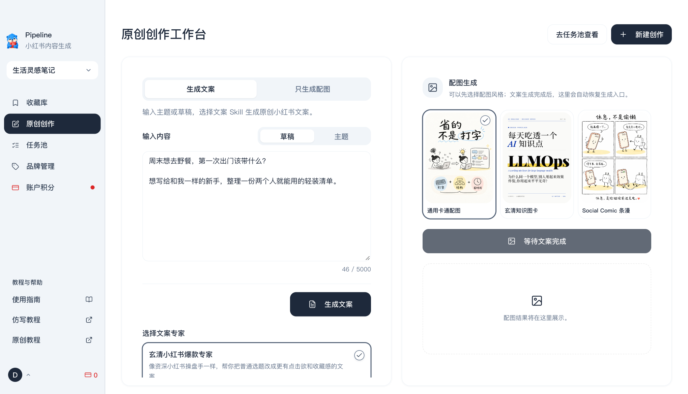

# Pipeline｜小红书内容生成

把一个主题、几行草稿或收藏的参考笔记，做成可编辑的小红书笔记。插件在 DeepSeek Harness 里生成标题、正文和配图，支持预览、复制和下载，最后由你检查并发布。

## 工作台长什么样？



上图是已发布插件的界面，使用演示数据。左边输入自己的选题或草稿，点击「生成文案」，再从右边选择一种画法，生成配图。下面是插件提供的三种风格样张。

| 通用卡通配图 | 玄清知识图卡 | Social Comic 条漫 |
| :---: | :---: | :---: |
|  |  |  |

## 在 Harness 里安装

打开 **插件 → 添加插件**，把下面的 GitHub 仓库地址粘贴到输入框，点击 **安装**。看到「已安装」后点击 **立即启用**，再从左侧打开 **Pipeline｜小红书内容生成**。Windows 和 Mac 使用同一个地址。

```text
https://github.com/xuanqing-95/pipeline-xhs-harness-downloads
```

<details>
<summary>其他安装方式</summary>

已添加收录本插件的索引时，可在「插件 → 发现」搜索「小红书内容生成」。也可添加[作者索引](https://raw.githubusercontent.com/xuanqing-95/pipeline-xhs-harness-downloads/main/index.json)。Mac 用户另有[备用安装包](https://github.com/xuanqing-95/pipeline-xhs-harness-downloads/releases/latest/download/Pipeline-XHS-Mac.zip)。

</details>

## 做第一篇笔记

1. 从 Harness 侧栏打开插件，登录或注册自己的 Pipeline 账号。生成文案和配图会使用 Pipeline 积分，可以先在「账户积分」查看余额。
2. 打开「原创创作」，选「主题」，输入一个选题，例如「两个人周末野餐要带什么？」，点击「生成文案」。
3. 检查标题和正文，选择配图风格并生成。在「任务池」打开成品预览，复制正文、下载图片，到小红书确认发布。

想从参考笔记开始写？在「收藏库」按提示安装配套的浏览器收藏扩展，收藏原帖后，回到插件点击「开始仿写」。
