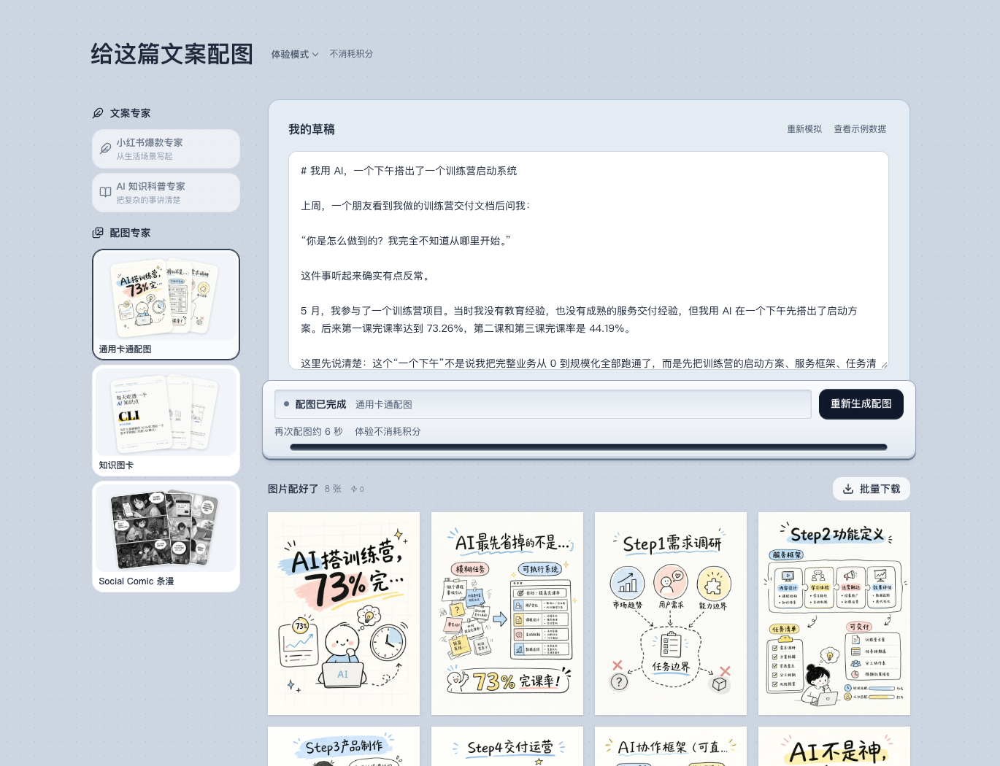

# Pipeline｜小红书内容生成

在 DeepSeek Harness 里把主题或草稿写成小红书笔记，接着配图、预览和批量下载。也可以从收藏库选一篇参考笔记开始仿写。正式创作使用你的 Pipeline 账号和积分，体验模式消耗 0 积分。

## 在 Harness 里安装

1. 打开 **插件 → 添加插件**。
2. 输入这个名字，点 **安装**。

   ```text
   dsh-pipeline-xhs
   ```

3. 安装完成后点 **立即启用**，从左侧打开 **Pipeline｜小红书内容生成**。

Mac 和 Windows 使用同一个名字。支持 DeepSeek Harness 0.2.2 系列，从 0.2.2-rc.1 起。[在 npm 查看版本](https://www.npmjs.com/package/dsh-pipeline-xhs) · [GitHub 正式版](https://github.com/xuanqing-95/pipeline-xhs-harness-downloads/releases/latest)

全新安装的 Harness 可以直接按上面的短包名安装。已经添加作者或 DSHDesk 社区索引的用户，也可以在「发现」搜索 **小红书内容生成**，打开插件卡片安装。[Harness 官方插件索引说明](https://github.com/deepseek-ai/deepseek-harness/blob/master/docs/user/guide/plugin-market.zh.md)

<details>
<summary>安装失败，详情里出现了 0.0.0-stage</summary>

回到「添加插件」，输入 `dsh-pipeline-xhs@0.5.4`，再点「安装」。这样会下载指定版本，跳过安装器记住的旧包。以后有新版本，插件仍会提示更新。

</details>

### 收到新版时

用上面的名字安装并启用后，插件会通过 Harness 的 npm 安装源检查更新。出现提醒时点 **立即更新**。想让插件在空闲时自行更新，可以在 **使用指南 → 插件更新** 勾选 **空闲时自动更新**。这里也可以手动检查版本。

已用短包名安装 beta.56 的用户可以直接更新到 0.5.4。仍在 beta.55 的用户可在 Harness 的「插件」页面打开 Pipeline 详情，展开「版本」，重新检查后选择 0.5.4。

<details>
<summary>已通过 GitHub 安装，或需要 Mac 安装包</summary>

通过索引或固定 Git 提交安装的 beta.56 会先收到 beta.57 提醒。按提示更新并重新加载，再次检查即可升到 0.5.4。通过普通 GitHub 地址或 Mac 安装包安装的用户，可从新版提醒打开安装说明。

[作者索引](https://raw.githubusercontent.com/xuanqing-95/pipeline-xhs-harness-downloads/main/index.json) · [GitHub 版本与备用安装包](https://github.com/xuanqing-95/pipeline-xhs-harness-downloads/releases/latest)

</details>

## 原创创作工作台



上图使用 **beta.54** 工作台组件与内置体验数据。左侧可选择文案和配图专家，例如通用卡通配图、知识图卡和 Social Comic 条漫。

1. 从 Harness 侧栏打开插件，登录自己的 Pipeline 账号。
2. 打开「原创创作」。想先试用时，从标题旁切换到「体验模式」，点击「填入示例数据」。正式创作可直接输入自己的主题、草稿或完整文案。
3. 选择文案专家后，先生成文案供你核对和修改。已有文案时可只选配图专家。配图完成后，工作台会滚到结果，可逐张预览或批量下载。
4. 从「任务池」找回正式创作任务，从「账户积分」核对消耗。想仿写时，可从「收藏库」选择已收藏的笔记。

本插件由玄清维护。
